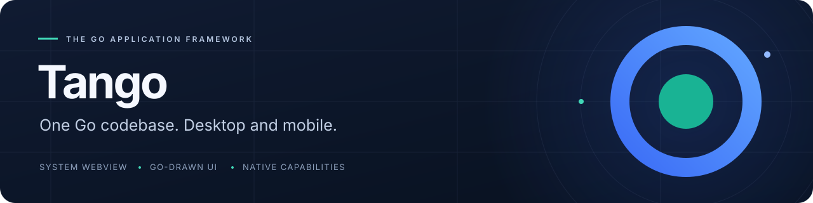
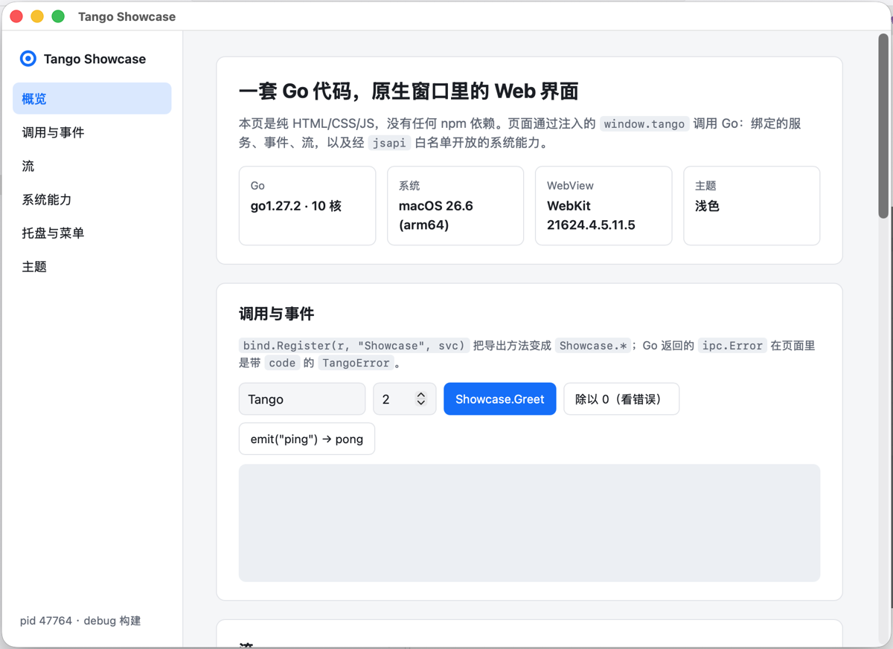

<p align="center">
  
</p>

<p align="center"><strong>使い慣れた Web 技術で。Go で描く UI で。OS の機能とともに。</strong></p>

<p align="center">
  <a href="site/en/index.md">ドキュメント</a> ·
  <a href="site/en/guide/getting-started.md">クイックスタート</a> ·
  <a href="https://pkg.go.dev/github.com/tangoui/tango">Go API</a> ·
  <a href="CHANGELOG.md">変更履歴</a>
</p>

<p align="center">
  <a href="https://github.com/tangoui/tango/actions/workflows/ci.yml"></a>
  <a href="https://pkg.go.dev/github.com/tangoui/tango"></a>
  <a href="https://www.npmjs.com/package/@tangoui/runtime"></a>
  <a href="go.mod"></a>
  <a href="LICENSE"></a>
</p>

<p align="center"><a href="README.md">English</a> · <a href="README.zh-CN.md">简体中文</a> · <a href="README.zh-TW.md">繁體中文</a> · <strong>日本語</strong></p>

Tango は **macOS、Windows、Linux、iOS、Android** 向けの Go アプリケーションフレームワークです。システム WebView と好みのフロントエンドを使うことも、Go のコンポーネントでデスクトップ UI を描画することも、両方を同じデスクトップウィンドウに組み合わせることもできます。

<p align="center">
  
  <br>
  <sub>Tango アプリの実例。システム WebView から、呼び出し・イベント・ストリームを通じて Go サービスを利用できます。</sub>
</p>

> **初期の 0.x バージョンです。** 公開 API は 1.0 までに変更される可能性があります。モバイルと Go 描画 UI は実験的機能です。検証範囲は下のプラットフォーム表をご確認ください。

## Tango を選ぶ理由

| 機能 | できること |
| --- | --- |
| 自由に選べるフロントエンド | システム WebView で HTML、TypeScript、React、Vue、shadcn/ui を利用できます。標準テンプレートは npm 不要です。 |
| Go で書く UI | Ant Design、Element Plus、shadcn のテーマとダークモードに対応したコンポーネント群。チャート、フォーム、テーブルも揃っています。 |
| 呼び出し・イベント・ストリーム | Go メソッドのバインディング、TypeScript クライアント生成、双方向イベント、キャンセルとバックプレッシャーに対応したストリーム。 |
| OS の機能との連携 | メニュー、トレイ、ダイアログ、通知、クリップボード、ショートカット、ディスプレイ、システム外観を個別の Go パッケージで提供します。 |
| 明示的なページ権限 | ページから利用できるシステム API を Go 側の許可リストで制御し、ブリッジでメッセージの送信元も検証します。 |
| 開発から配布まで | テンプレート、自動再ビルド、Go 描画ウィンドウのホットリロード、パッケージ化、コード署名、署名付き自動更新。 |

## アプリのサイズ

**ダウンロードサイズ：** 標準テンプレートでは、ユーザーがダウンロードするインストーラー（`.dmg`、`.exe`、`.deb`、`.rpm`、`.AppImage`、`.tar.gz`）は **2.78–5.11 MB** です。インストール後の実行ファイルは、WebView アプリで **7.86–8.69 MB**、Go 描画 UI アプリで **9.77–11.65 MB** です。

| 対象 | 配布形式 | WebView アプリ | Go UI アプリ |
| --- | --- | ---: | ---: |
| macOS / arm64 | `.dmg` | 3.51 MB | 4.57 MB |
| macOS / amd64（Intel） | `.dmg` | 3.86 MB | 5.11 MB |
| Windows / amd64 | NSIS `.exe` | 2.78 MB | 3.64 MB |
| Linux / amd64 | `.deb` | 3.49 MB | 4.50 MB |
| Linux / amd64 | `.rpm` | 3.49 MB | 4.51 MB |
| Linux / amd64 | `.AppImage` | 4.10 MB | 5.02 MB |
| Linux / amd64 | `.tar.gz` | 3.58 MB | 4.62 MB |
| Linux / arm64 | `.deb` | 3.18 MB | 4.06 MB |
| Linux / arm64 | `.rpm` | 3.19 MB | 4.06 MB |
| Linux / arm64 | `.AppImage` | 3.77 MB | 4.56 MB |
| Linux / arm64 | `.tar.gz` | 3.26 MB | 4.15 MB |

**2026-11-13** に Go **1.27.2**、コミット `36322bc`、`CGO_ENABLED=0`、`-trimpath`、`-ldflags="-s -w"` で測定。MB = 1,000,000 バイト。標準テンプレートの測定例であり、最小値や完成したアプリのサイズを保証するものではありません。システムライブラリと WebView ランタイムは含みません。インストーラーは正式な署名なし（macOS は ad-hoc 署名のみ）で、Flatpak、Windows arm64、モバイルパッケージは未測定です。[測定記録と再現手順（中国語）](docs/package-size.md)をご覧ください。

## UI の作り方を選ぶ

| UI | 用途 | テンプレート |
| --- | --- | --- |
| **WebView** | 既存の Web 技術から、Go サービスと OS の機能を利用するアプリ。 | `vanilla` · `vanilla-ts` · `react-ts` · `vue-ts` · `shadcn` |
| **Go 描画 UI** | Web フロントエンドを使わず、Go コンポーネントで作るデスクトップ UI。 | `ui` |
| **ハイブリッド** | WebView と Go 描画パネルを同じデスクトップウィンドウに配置するアプリ。 | `hybrid` |

Go 描画 UI は現在デスクトップ向けです。モバイルでは WebView を使用します。ハイブリッドアプリは Go コードの変更時に再起動し、Canvas のホットリロードは利用しません。

## 開発を始める

**Go 1.27+** が必要です。デスクトップビルドに cgo は不要ですが、実行先にはシステム WebView のライブラリが必要です。モバイルビルドには各プラットフォームの SDK が必要です。

```bash
go install github.com/tangoui/tango/cmd/tan@latest
tan init hello          # HTML/CSS/JS のみ。npm 不要
cd hello
tan dev                 # Go コードの変更時に自動で再ビルド
tan build               # build/ にリリースビルドを生成
```

<details>
<summary>別のテンプレートから始めることもできます。</summary>

```bash
tan init -template react-ts my-react-app   # React + TypeScript + Vite
tan init -template vue-ts my-vue-app       # Vue + TypeScript + Vite
tan init -template shadcn my-shadcn-app    # React + Tailwind CSS + shadcn/ui
tan init -template ui my-go-app            # Go 描画コンポーネント
tan init -template hybrid my-hybrid-app    # WebView + Go 描画ツールパネル
```

</details>

シミュレータまたは接続済み Android 端末で実行（実験的）：

```bash
tan run -platform ios-simulator
tan run -platform android
```

SDK、署名、端末の要件は[モバイル設定（中国語）](docs/mobile.md)をご覧ください。

## Go サービスをページから呼び出す

IPC ルーターとランタイムブリッジを設定したアプリでは、Go サービスを次のように公開できます。

```go
type Greeter struct{}

func (Greeter) Hello(name string) string {
	return "Hello, " + name + "!"
}

// アプリの IPC ルーターに登録。
func registerServices(router *ipc.Router) error {
	return bind.Register(router, "Greeter", Greeter{})
}
```

ページ側から呼び出します。

```javascript
const message = await window.tango.call("Greeter.Hello", "Tango");
// "Hello, Tango!"
```

`tan generate bindings` で型付き TypeScript クライアントを生成できます。実行可能な [hello サンプル](examples/hello)には、ブリッジの設定、イベント、ストリームが含まれます。

## プラットフォーム対応

| 対象 | UI | 検証範囲 |
| --- | --- | --- |
| **macOS** | システム WebView · Go 描画 UI · ハイブリッド | macOS 実機で検証済み。 |
| **Windows** | システム WebView · Go 描画 UI · ハイブリッド | 実装済み。クロスコンパイルと CI スモークテストに対応。体系的な実機検証は未完了。 |
| **Linux** | システム WebView · Go 描画 UI · ハイブリッド | 実装済み。クロスコンパイルと CI スモークテストに対応。体系的な実機検証は未完了。 |
| **iOS** | システム WebView | 実験的。シミュレータで検証済み。実機検証は未完了。 |
| **Android** | システム WebView | 実験的。エミュレータで検証済み。実機検証は未完了。 |

機能はプラットフォームによって異なります。[WebView 対応表](docs/webview.md)、[モバイル機能](docs/mobile.md)、[ランタイム API](docs/runtime-api.md)をご確認ください。これらの詳細資料は中国語です。Android プッシュ通知にはアプリ側の FCM 統合が必要です。Play Billing と iOS Widget は内蔵していません。

## サンプルを試す

| サンプル | 内容 |
| --- | --- |
| [`examples/showcase`](examples/showcase) | 呼び出し、イベント、ストリーム、メニュー、トレイ、通知、システムテーマとの連動。 |
| [`examples/hello`](examples/hello) | 小さなエンドツーエンドのブリッジサンプル。 |
| [`examples/runtime-demo`](examples/runtime-demo) | JavaScript から OS の機能を利用。 |
| [`examples/ui-window`](examples/ui-window) | Go で描画するデスクトップウィンドウ。 |
| [`examples/ui-gallery`](examples/ui-gallery) | コンポーネント、テーマ、チャート、フォームのギャラリー画像を生成。 |
| [`examples/webview-overlay`](examples/webview-overlay) | WebView と Go 描画コンテンツを同じデスクトップウィンドウに配置。 |
| [`examples/mobile-hello`](examples/mobile-hello) | モバイルのページ、ライフサイクル、OS 機能のデモ。 |
| [`examples/ledger`](examples/ledger) | 自前描画 UI の家計簿アプリ一式：トレイ、CSV 出力、`tan build` でのパッケージング。 |
| [`examples/ui-hotreload`](examples/ui-hotreload) | `tan dev` での自前描画 UI のホットリロード（再ビルド後も状態を保持）。 |
| [`examples/editor-demo`](examples/editor-demo) | `ui/editor` コードエディタ。大きなファイルをバックグラウンドで構文ハイライト。 |
| [`examples/a11y-demo`](examples/a11y-demo) | スクリーンリーダー（VoiceOver）から見た自前描画 UI とアクセシビリティ自己チェック。 |
| [`examples/i18n-demo`](examples/i18n-demo) | システム言語、アプリのメッセージカタログ、ローカライズされたネイティブメニュー。 |
| [`examples/app-demo`](examples/app-demo) | 終了の確認、ディープリンクとファイルを開く、単一インスタンス。 |
| [`examples/webview-demo`](examples/webview-demo) | WebView の高度な機能：権限、ダウンロード、Cookie、認証、ページ内検索、PDF/PNG キャプチャ。 |
| [`examples/print-demo`](examples/print-demo) | システムの印刷ダイアログ、PDF 出力、ドキュメントと画像の印刷。 |
| [`examples/system-demo`](examples/system-demo) | 画面、テーマ、シェル、自動起動、環境情報の統合チェック。 |
| [`examples/sysx-demo`](examples/sysx-demo) | セキュアストレージ、電源、ネットワーク、トレイのフライアウト、Dock メニュー／ジャンプリスト、ファイルのドラッグアウト。 |
| [`examples/notify-demo`](examples/notify-demo) | クリップボード画像、グローバルホットキー、通知、ウィンドウショートカットのスモークテスト。 |

このリポジトリのチェックアウト内で実行します。

```bash
go run ./examples/showcase
```

## ドキュメント

| トピック | 資料 |
| --- | --- |
| はじめに | [英語ガイド](site/en/guide/getting-started.md) · [CLI（英語）](site/en/reference/cli.md) · [Go API](https://pkg.go.dev/github.com/tangoui/tango) |
| コアとブリッジ | [アーキテクチャ](docs/architecture.md) · [ランタイム API](docs/runtime-api.md) · [WebView](docs/webview.md) |
| ビルドと配布 | [リリース](docs/release.md) · [パッケージ化](docs/packaging.md) · [Windows](docs/windows.md) · [Linux](docs/linux-packaging.md) · [自動更新](docs/updates.md) |
| OS 連携 | [モバイル](docs/mobile.md) · [権限](docs/mobile-permissions.md) · [アイコン](docs/icons.md) · [印刷](docs/print.md) |
| 品質とツール | [アクセシビリティ](docs/accessibility.md) · [自動化](docs/automation.md) · [Panic 処理](docs/panics.md) · [CI](docs/ci.md) |

README は英語・簡体字中国語・繁体字中国語・日本語で提供しています。詳細ドキュメントは主に中国語です。英語ガイドと自動生成の Go API リファレンスもあります。

## コントリビュート

Issue とプルリクエストを歓迎します。開発手順と DCO の署名要件は [CONTRIBUTING.md](CONTRIBUTING.md) をご確認ください。[行動規範](CODE_OF_CONDUCT.md)を守り、脆弱性は [SECURITY.md](SECURITY.md) に従って非公開で報告してください。

---

<p align="center"><a href="LICENSE">MIT</a> © 2026 Tango contributors.</p>
