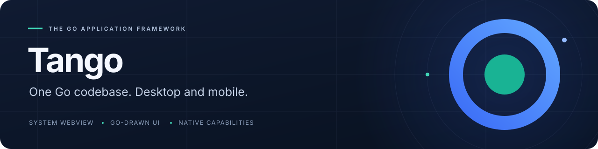
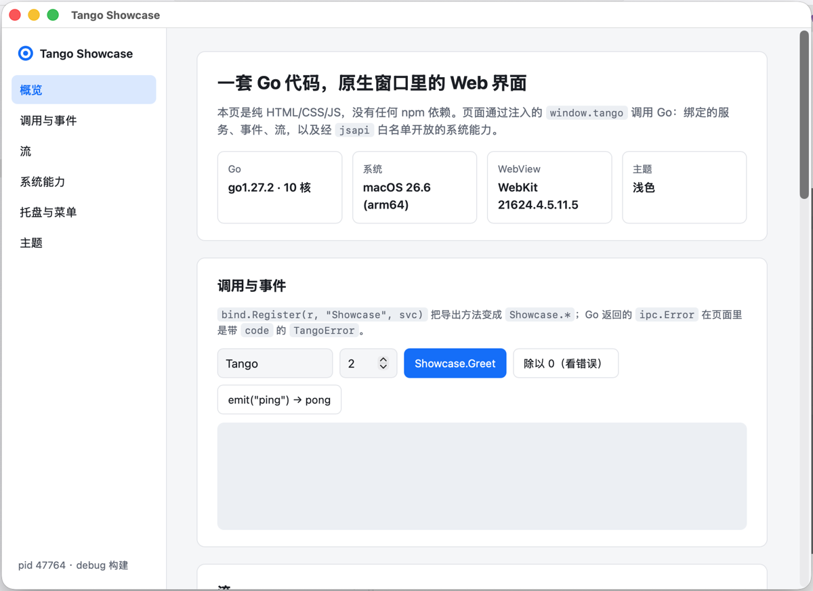

<p align="center">
  
</p>

<p align="center"><strong>Build with your web stack. Draw in Go. Connect to the system.</strong></p>

<p align="center">
  <a href="site/en/index.md">Documentation</a> ·
  <a href="site/en/guide/getting-started.md">Quick start</a> ·
  <a href="https://pkg.go.dev/github.com/tangoui/tango">Go reference</a> ·
  <a href="CHANGELOG.md">Changelog</a>
</p>

<p align="center">
  <a href="https://github.com/tangoui/tango/actions/workflows/ci.yml"></a>
  <a href="https://pkg.go.dev/github.com/tangoui/tango"></a>
  <a href="https://www.npmjs.com/package/@tangoui/runtime"></a>
  <a href="go.mod"></a>
  <a href="LICENSE"></a>
</p>

<p align="center"><strong>English</strong> · <a href="README.zh-CN.md">简体中文</a> · <a href="README.zh-TW.md">繁體中文</a> · <a href="README.ja.md">日本語</a></p>

Tango is a Go application framework for **macOS, Windows, Linux, iOS and Android**. Use a system WebView with your preferred frontend, build a desktop interface with Go-drawn components, or combine both in one desktop window.

<p align="center">
  
  <br>
  <sub>A real Tango application: a system WebView connected to Go services, events and streams.</sub>
</p>

> **Early 0.x.** Public APIs may change before 1.0. Mobile and Go-drawn UI are experimental; see the platform matrix below for the current verification scope.

## Why Tango

| Capability | What you get |
| --- | --- |
| Your frontend, your choice | Plain HTML, TypeScript, React, Vue or shadcn/ui in a system WebView. The default template needs no npm. |
| UI written in Go | A component library with Ant Design, Element Plus and shadcn themes, including dark variants, charts, forms and tables. |
| Calls, events and streams | Go method bindings, generated TypeScript clients, bidirectional events, and cancellable streams with backpressure. |
| Native integration | Menus, tray icons, dialogs, notifications, clipboard, shortcuts, displays and system appearance through focused Go packages. |
| Explicit page permissions | A Go-side capability allowlist controls page access to system APIs; the bridge also checks message origins. |
| Development to distribution | Project templates, automatic rebuilds, hot reload for Go-drawn windows, packaging, signing and signed auto-updates. |

## Application size

**Download size:** with the default templates, the installer a user downloads (`.dmg`, `.exe`, `.deb`, `.rpm`, `.AppImage`, `.tar.gz`) is **2.78–5.11 MB**. Once installed, the executable is **7.86–8.69 MB** for a WebView app and **9.77–11.65 MB** for a Go-drawn UI app.

| Target | Download format | WebView app | Go UI app |
| --- | --- | ---: | ---: |
| macOS / arm64 | `.dmg` | 3.51 MB | 4.57 MB |
| macOS / amd64 (Intel) | `.dmg` | 3.86 MB | 5.11 MB |
| Windows / amd64 | NSIS `.exe` | 2.78 MB | 3.64 MB |
| Linux / amd64 | `.deb` | 3.49 MB | 4.50 MB |
| Linux / amd64 | `.rpm` | 3.49 MB | 4.51 MB |
| Linux / amd64 | `.AppImage` | 4.10 MB | 5.02 MB |
| Linux / amd64 | `.tar.gz` | 3.58 MB | 4.62 MB |
| Linux / arm64 | `.deb` | 3.18 MB | 4.06 MB |
| Linux / arm64 | `.rpm` | 3.19 MB | 4.06 MB |
| Linux / arm64 | `.AppImage` | 3.77 MB | 4.56 MB |
| Linux / arm64 | `.tar.gz` | 3.26 MB | 4.15 MB |

Measured on **2026-11-13**, Go **1.27.2**, commit `36322bc`, with `CGO_ENABLED=0`, `-trimpath` and `-ldflags="-s -w"`; MB = 1,000,000 bytes. These are default-template samples, not minimum sizes or guarantees for a finished app. System libraries / WebView runtimes are excluded. Installers are not formally signed (macOS is ad-hoc signed only); Flatpak, Windows arm64 and mobile packages were not measured. See the [measurement record and reproduction steps](docs/package-size.md).

## Choose how you build

| Interface | Best for | Template |
| --- | --- | --- |
| **WebView** | Your existing web stack, with Go services and native capabilities. | `vanilla` · `vanilla-ts` · `react-ts` · `vue-ts` · `shadcn` |
| **Go-drawn UI** | Desktop interfaces built from Go components, without a web frontend. | `ui` |
| **Hybrid** | A WebView with an attached Go-drawn panel in the same desktop window. | `hybrid` |

Go-drawn UI currently targets desktop. Mobile uses WebView pages; hybrid apps restart on Go changes instead of using canvas hot reload.

## Start building

Requires **Go 1.27+**. Desktop builds do not require cgo; the target platform still needs its system WebView libraries. Mobile builds need the relevant SDKs.

```bash
go install github.com/tangoui/tango/cmd/tan@latest
tan init hello          # Plain HTML/CSS/JS; no npm needed
cd hello
tan dev                 # Run the app; rebuild when Go code changes
tan build               # Create a release build in build/
```

A plain `go build` / `go run .` is a production build too. Development features (hot reload, the automation channel, the front-end dev-server proxy) exist only in builds with `-tags tango_dev`, which `tan dev` adds; see [development features and production builds](docs/dev-builds.md).

<details>
<summary>Choose another starting point:</summary>

```bash
tan init -template react-ts my-react-app   # React + TypeScript + Vite
tan init -template vue-ts my-vue-app       # Vue + TypeScript + Vite
tan init -template shadcn my-shadcn-app    # React + Tailwind CSS + shadcn/ui
tan init -template ui my-go-app            # Go-drawn components
tan init -template hybrid my-hybrid-app    # WebView + a Go-drawn tool panel
```

</details>

Run on a simulator or connected Android device (experimental):

```bash
tan run -platform ios-simulator
tan run -platform android
```

See [mobile setup](docs/mobile.md) for SDKs, signing and device requirements.

## Go services, one call away

Once your app has an IPC router and the runtime bridge installed, expose a Go service:

```go
type Greeter struct{}

func (Greeter) Hello(name string) string {
	return "Hello, " + name + "!"
}

// Register with your app’s IPC router.
func registerServices(router *ipc.Router) error {
	return bind.Register(router, "Greeter", Greeter{})
}
```

Call it from the page:

```javascript
const message = await window.tango.call("Greeter.Hello", "Tango");
// "Hello, Tango!"
```

Use `tan generate bindings` for a typed TypeScript client. The runnable [hello example](examples/hello) includes the complete bridge setup, events and a stream.

## Platform support

| Target | Interface | Verification |
| --- | --- | --- |
| **macOS** | System WebView · Go-drawn UI · hybrid | Verified on macOS hardware. |
| **Windows** | System WebView · Go-drawn UI · hybrid | Implemented; cross-compilation and CI smoke coverage. Systematic hardware validation is pending. |
| **Linux** | System WebView · Go-drawn UI · hybrid | Implemented; cross-compilation and CI smoke coverage. Systematic hardware validation is pending. |
| **iOS** | System WebView · Go-drawn UI | Experimental; simulator validation, plus one hardware run (iPhone 12 Pro, iOS 27): WebView and Go-drawn example apps, touch, input method, Metal and CPU rendering, accessibility. Broader hardware validation is pending. |
| **Android** | System WebView | Experimental; emulator validation. Hardware validation is pending. |

Capabilities differ by platform. Check [WebView support](docs/webview.md), [mobile capabilities](docs/mobile.md) and [runtime APIs](docs/runtime-api.md) before relying on a feature. Android push requires app-provided FCM integration; Play Billing and iOS widgets are not built in.

## Explore the examples

| Example | Explore |
| --- | --- |
| [`examples/showcase`](examples/showcase) | Calls, events, streams, menus, tray icons, notifications and theme following. |
| [`examples/hello`](examples/hello) | A small end-to-end bridge example. |
| [`examples/runtime-demo`](examples/runtime-demo) | JavaScript access to native capabilities. |
| [`examples/ui-window`](examples/ui-window) | A desktop window drawn in Go. |
| [`examples/ui-gallery`](examples/ui-gallery) | Components, themes, charts and forms; generates gallery images. |
| [`examples/webview-overlay`](examples/webview-overlay) | A WebView and Go-drawn content sharing a desktop window. |
| [`examples/mobile-hello`](examples/mobile-hello) | Mobile pages, lifecycle and system capability demos. |
| [`examples/ledger`](examples/ledger) | A complete bookkeeping app in self-drawn UI: tray, CSV export, packaged with `tan build`. |
| [`examples/ui-hotreload`](examples/ui-hotreload) | Hot reload of self-drawn UI under `tan dev`, keeping state across rebuilds. |
| [`examples/editor-demo`](examples/editor-demo) | The `ui/editor` code editor with background syntax highlighting on large files. |
| [`examples/a11y-demo`](examples/a11y-demo) | How screen readers see self-drawn UI (VoiceOver), with an accessibility self-check. |
| [`examples/i18n-demo`](examples/i18n-demo) | System languages, an app message catalog and localized native menus. |
| [`examples/app-demo`](examples/app-demo) | Quit interception, deep links and opened files, single instance. |
| [`examples/webview-demo`](examples/webview-demo) | Advanced WebView: permissions, downloads, cookies, auth, find in page, PDF/PNG capture. |
| [`examples/print-demo`](examples/print-demo) | System print dialog, PDF export and printing documents and images. |
| [`examples/system-demo`](examples/system-demo) | Screen, theme, shell, autostart and environment integration checks. |
| [`examples/sysx-demo`](examples/sysx-demo) | Secure storage, power, network, tray flyouts, Dock menu / Jump List, file drag-out. |
| [`examples/notify-demo`](examples/notify-demo) | Clipboard images, global hotkeys, notifications and window shortcuts smoke test. |

From a checkout of this repository:

```bash
go run ./examples/showcase
```

## Documentation

| Topic | Read |
| --- | --- |
| Get started | [English guide](site/en/guide/getting-started.md) · [CLI](site/en/reference/cli.md) · [Go packages](https://pkg.go.dev/github.com/tangoui/tango) |
| Core and bridge | [Architecture](docs/architecture.md) · [Runtime API](docs/runtime-api.md) · [WebView](docs/webview.md) |
| Build and ship | [Release](docs/release.md) · [Packaging](docs/packaging.md) · [Windows](docs/windows.md) · [Linux packages](docs/linux-packaging.md) · [Auto-updates](docs/updates.md) |
| System integration | [Mobile](docs/mobile.md) · [Permissions](docs/mobile-permissions.md) · [Icons](docs/icons.md) · [Printing](docs/print.md) |
| Quality and tooling | [Dev features vs production builds](docs/dev-builds.md) · [Accessibility](docs/accessibility.md) · [Automation](docs/automation.md) · [Panic handling](docs/panics.md) · [CI and smoke tests](docs/ci.md) |

README translations cover English, Simplified Chinese, Traditional Chinese and Japanese. Most detailed documentation is currently in Chinese; English guides and the generated Go API reference are available.

## Contribute

Issues and pull requests are welcome. Read [CONTRIBUTING.md](CONTRIBUTING.md) for development and DCO sign-off requirements, follow the [Code of Conduct](CODE_OF_CONDUCT.md), and report vulnerabilities privately using [SECURITY.md](SECURITY.md).

---

<p align="center"><a href="LICENSE">MIT</a> © 2026 Tango contributors.</p>
