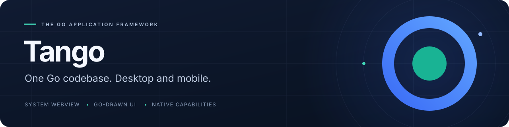
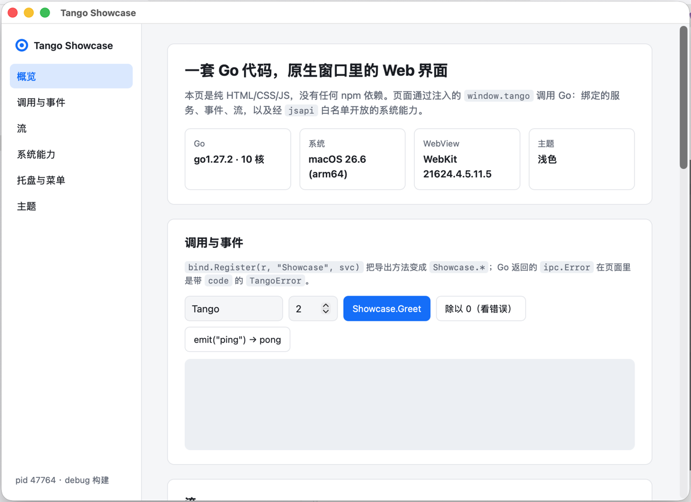

<p align="center">
  
</p>

<p align="center"><strong>用熟悉的 Web 技术写页面，用 Go 绘制界面，与系统能力相连。</strong></p>

<p align="center">
  <a href="site/index.md">文档</a> ·
  <a href="site/guide/getting-started.md">快速开始</a> ·
  <a href="https://pkg.go.dev/github.com/tangoui/tango">Go API</a> ·
  <a href="CHANGELOG.md">更新日志</a>
</p>

<p align="center">
  <a href="https://github.com/tangoui/tango/actions/workflows/ci.yml"></a>
  <a href="https://pkg.go.dev/github.com/tangoui/tango"></a>
  <a href="https://www.npmjs.com/package/@tangoui/runtime"></a>
  <a href="go.mod"></a>
  <a href="LICENSE"></a>
</p>

<p align="center"><a href="README.md">English</a> · <strong>简体中文</strong> · <a href="README.zh-TW.md">繁體中文</a> · <a href="README.ja.md">日本語</a></p>

Tango 是面向 **macOS、Windows、Linux、iOS 与 Android** 的 Go 应用框架。你可以在系统 WebView 中使用喜欢的前端技术，用 Go 组件构建桌面自绘界面，也可以把两者组合在同一个桌面窗口中。

<p align="center">
  
  <br>
  <sub>真实的 Tango 应用：系统 WebView 通过调用、事件和流连接 Go 服务。</sub>
</p>

> **0.x 早期版本。** 公开 API 在 1.0 前可能变化。移动端与 Go 自绘 UI 属于实验性能力，具体验证范围见下方平台支持表。

## 为什么选择 Tango

| 能力 | 你能获得什么 |
| --- | --- |
| 前端技术自由选择 | 系统 WebView 支持纯 HTML、TypeScript、React、Vue 与 shadcn/ui；默认模板不需要 npm。 |
| 用 Go 编写界面 | 组件库提供 Ant Design、Element Plus、shadcn 三种主题及深色变体，涵盖图表、表单与表格。 |
| 调用、事件与流 | Go 方法绑定、TypeScript 客户端生成、双向事件，以及支持取消和背压的流。 |
| 原生系统集成 | 菜单、托盘、对话框、通知、剪贴板、快捷键、显示器与系统外观，每种能力由独立 Go 包提供。 |
| 明确的页面权限 | 页面访问系统 API 由 Go 侧能力白名单控制，桥接层同时校验消息来源。 |
| 从开发到分发 | 项目模板、自动重建、自绘窗口热加载、安装包、代码签名与签名自动更新。 |

## 应用包体积

**下载体积：**默认模板下，用户下载的安装包（`.dmg`、`.exe`、`.deb`、`.rpm`、`.AppImage`、`.tar.gz`）为 **2.78–5.11 MB**；安装后的可执行文件，WebView 应用为 **7.86–8.69 MB**，Go 自绘 UI 应用为 **9.77–11.65 MB**。

| 目标平台 | 下载格式 | WebView 应用 | 自绘 UI 应用 |
| --- | --- | ---: | ---: |
| macOS / arm64 | `.dmg` | 3.51 MB | 4.57 MB |
| macOS / amd64（Intel） | `.dmg` | 3.86 MB | 5.11 MB |
| Windows / amd64 | NSIS `.exe` | 2.78 MB | 3.64 MB |
| Linux / amd64 | `.deb` | 3.49 MB | 4.50 MB |
| Linux / amd64 | `.rpm` | 3.49 MB | 4.51 MB |
| Linux / amd64 | `.AppImage` | 4.10 MB | 5.02 MB |
| Linux / amd64 | `.tar.gz` | 3.58 MB | 4.62 MB |
| Linux / arm64 | `.deb` | 3.18 MB | 4.06 MB |
| Linux / arm64 | `.rpm` | 3.19 MB | 4.06 MB |
| Linux / arm64 | `.AppImage` | 3.77 MB | 4.56 MB |
| Linux / arm64 | `.tar.gz` | 3.26 MB | 4.15 MB |

实测日期 **2026-11-13**，Go **1.27.2**，提交 `36322bc`，使用 `CGO_ENABLED=0`、`-trimpath`、`-ldflags="-s -w"`；MB = 1,000,000 字节。这是默认模板样本，不是理论最小值或完整业务应用的体积承诺；不含系统库与 WebView 运行时。安装包均未正式签名（macOS 仅 ad-hoc 签名），Flatpak、Windows arm64 与移动安装包未取得测量值。[完整测量记录与复现步骤](docs/package-size.md)。

## 选择你的界面方式

| 界面 | 适用场景 | 模板 |
| --- | --- | --- |
| **WebView** | 沿用已有前端技术，接入 Go 服务与原生系统能力。 | `vanilla` · `vanilla-ts` · `react-ts` · `vue-ts` · `shadcn` |
| **Go 自绘 UI** | 直接用 Go 组件构建桌面界面，无需 Web 前端。 | `ui` |
| **混合界面** | 在同一个桌面窗口中，为 WebView 附加 Go 自绘面板。 | `hybrid` |

Go 自绘 UI 目前面向桌面；移动端使用 WebView 页面。混合界面在 Go 代码变化后重启应用，不使用 Canvas 热加载。

## 开始构建

需要 **Go 1.27+**。桌面构建不需要 cgo，但目标系统仍需相应的 WebView 运行库；移动端构建需要对应 SDK。

```bash
go install github.com/tangoui/tango/cmd/tan@latest
tan init hello          # 纯 HTML/CSS/JS，无需 npm
cd hello
tan dev                 # 运行应用，Go 代码变化后自动重建
tan build               # 发布构建，产物位于 build/
```

<details>
<summary>也可以选择其他起点：</summary>

```bash
tan init -template react-ts my-react-app   # React + TypeScript + Vite
tan init -template vue-ts my-vue-app       # Vue + TypeScript + Vite
tan init -template shadcn my-shadcn-app    # React + Tailwind CSS + shadcn/ui
tan init -template ui my-go-app            # Go 自绘组件
tan init -template hybrid my-hybrid-app    # WebView + Go 自绘工具面板
```

</details>

在模拟器或已连接的 Android 设备上运行（实验性）：

```bash
tan run -platform ios-simulator
tan run -platform android
```

SDK、签名与设备要求见[移动端配置](docs/mobile.md)。

## Go 服务，一次调用即可到达

应用安装好 IPC 路由与运行时桥接后，就可以暴露 Go 服务：

```go
type Greeter struct{}

func (Greeter) Hello(name string) string {
	return "Hello, " + name + "!"
}

// 注册到应用的 IPC 路由。
func registerServices(router *ipc.Router) error {
	return bind.Register(router, "Greeter", Greeter{})
}
```

在页面中调用：

```javascript
const message = await window.tango.call("Greeter.Hello", "Tango");
// "Hello, Tango!"
```

使用 `tan generate bindings` 生成带类型的 TypeScript 客户端。[hello 示例](examples/hello)包含完整桥接配置、事件与流，可直接运行。

## 平台支持

| 平台 | 界面 | 验证范围 |
| --- | --- | --- |
| **macOS** | 系统 WebView · Go 自绘 · 混合界面 | 已在 macOS 实机验证。 |
| **Windows** | 系统 WebView · Go 自绘 · 混合界面 | 已有实现，具备交叉编译与 CI 冒烟覆盖；系统性的实机验证仍待补齐。 |
| **Linux** | 系统 WebView · Go 自绘 · 混合界面 | 已有实现，具备交叉编译与 CI 冒烟覆盖；系统性的实机验证仍待补齐。 |
| **iOS** | 系统 WebView · Go 自绘界面 | 实验性，已做模拟器验证，另在一台真机（iPhone 12 Pro，iOS 27）上跑通 WebView 与自绘示例：触摸、输入法、Metal 与 CPU 渲染、无障碍。更多机型的真机验证仍待补齐。 |
| **Android** | 系统 WebView | 实验性，已做模拟器验证；真机验证仍待补齐。 |

不同平台的能力存在差异，使用前请查阅 [WebView 支持矩阵](docs/webview.md)、[移动端能力](docs/mobile.md)与[运行时 API](docs/runtime-api.md)。Android 推送需要应用自行接入 FCM；目前未内置 Play Billing 与 iOS Widget。

## 探索示例

| 示例 | 内容 |
| --- | --- |
| [`examples/showcase`](examples/showcase) | 调用、事件、流、菜单、托盘、通知与主题跟随。 |
| [`examples/hello`](examples/hello) | 精简的端到端桥接示例。 |
| [`examples/runtime-demo`](examples/runtime-demo) | 通过 JavaScript 使用原生系统能力。 |
| [`examples/ui-window`](examples/ui-window) | 一个由 Go 绘制的桌面窗口。 |
| [`examples/ui-gallery`](examples/ui-gallery) | 组件、主题、图表与表单，生成画廊图片。 |
| [`examples/webview-overlay`](examples/webview-overlay) | 同一个桌面窗口中的 WebView 与 Go 自绘内容。 |
| [`examples/mobile-hello`](examples/mobile-hello) | 移动端页面、生命周期与系统能力演示。 |
| [`examples/ledger`](examples/ledger) | 完整的自绘 UI 记账应用：托盘、CSV 导出，用 `tan build` 打包。 |
| [`examples/ui-hotreload`](examples/ui-hotreload) | `tan dev` 下自绘 UI 热重载，重建后保留状态。 |
| [`examples/editor-demo`](examples/editor-demo) | `ui/editor` 代码编辑器，大文件后台语法高亮。 |
| [`examples/a11y-demo`](examples/a11y-demo) | 读屏软件（VoiceOver）眼中的自绘 UI，附无障碍自检。 |
| [`examples/i18n-demo`](examples/i18n-demo) | 系统语言、应用文案目录与本地化原生菜单。 |
| [`examples/app-demo`](examples/app-demo) | 退出拦截、深度链接与打开文件、单实例。 |
| [`examples/webview-demo`](examples/webview-demo) | WebView 高级功能：权限、下载、Cookie、认证、页内查找、PDF/PNG 截取。 |
| [`examples/print-demo`](examples/print-demo) | 系统打印对话框、导出 PDF、打印文档与图片。 |
| [`examples/system-demo`](examples/system-demo) | 屏幕、主题、Shell、开机自启与环境信息集成检查。 |
| [`examples/sysx-demo`](examples/sysx-demo) | 安全存储、电源、网络、托盘弹出面板、Dock 菜单/跳转列表、文件拖出。 |
| [`examples/notify-demo`](examples/notify-demo) | 剪贴板图片、全局快捷键、通知与窗口快捷键冒烟测试。 |

在仓库目录中运行：

```bash
go run ./examples/showcase
```

## 文档导航

| 主题 | 阅读入口 |
| --- | --- |
| 开始使用 | [快速开始](site/guide/getting-started.md) · [CLI](site/reference/cli.md) · [Go API](https://pkg.go.dev/github.com/tangoui/tango) |
| 核心与桥接 | [架构](docs/architecture.md) · [运行时 API](docs/runtime-api.md) · [WebView](docs/webview.md) |
| 构建与分发 | [发布流程](docs/release.md) · [安装包](docs/packaging.md) · [Windows](docs/windows.md) · [Linux 打包](docs/linux-packaging.md) · [自动更新](docs/updates.md) |
| 系统集成 | [移动端](docs/mobile.md) · [权限](docs/mobile-permissions.md) · [图标](docs/icons.md) · [打印](docs/print.md) |
| 质量与工具 | [无障碍](docs/accessibility.md) · [自动化](docs/automation.md) · [Panic 处理](docs/panics.md) · [CI 与冒烟测试](docs/ci.md) |

README 提供英文、简体中文、繁体中文与日文版本。详细文档目前以中文为主，另有英文指南及自动生成的 Go API 参考。

## 参与贡献

欢迎 issue 与 PR。开发与 DCO 签署要求见 [CONTRIBUTING.md](CONTRIBUTING.md)，参与请遵守[行为准则](CODE_OF_CONDUCT.md)，安全漏洞请按 [SECURITY.md](SECURITY.md) 私下报告。

---

<p align="center"><a href="LICENSE">MIT</a> © 2026 Tango contributors。</p>
