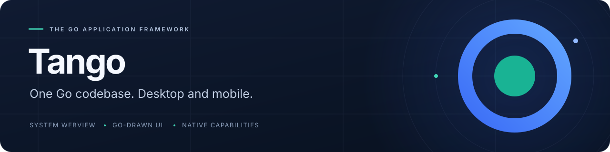
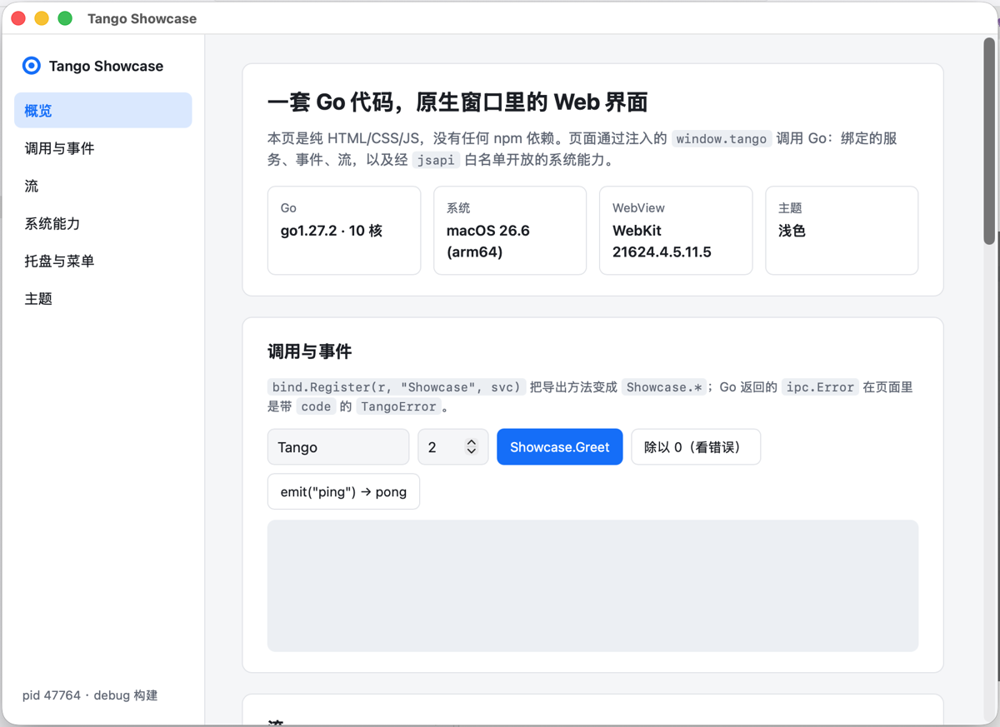

<p align="center">
  
</p>

<p align="center"><strong>以熟悉的 Web 技術製作頁面，以 Go 繪製介面，串接系統功能。</strong></p>

<p align="center">
  <a href="site/index.md">文件</a> ·
  <a href="site/guide/getting-started.md">快速開始</a> ·
  <a href="https://pkg.go.dev/github.com/tangoui/tango">Go API</a> ·
  <a href="CHANGELOG.md">更新日誌</a>
</p>

<p align="center">
  <a href="https://github.com/tangoui/tango/actions/workflows/ci.yml"></a>
  <a href="https://pkg.go.dev/github.com/tangoui/tango"></a>
  <a href="https://www.npmjs.com/package/@tangoui/runtime"></a>
  <a href="go.mod"></a>
  <a href="LICENSE"></a>
</p>

<p align="center"><a href="README.md">English</a> · <a href="README.zh-CN.md">简体中文</a> · <strong>繁體中文</strong> · <a href="README.ja.md">日本語</a></p>

Tango 是適用於 **macOS、Windows、Linux、iOS 與 Android** 的 Go 應用程式框架。你可以在系統 WebView 中使用喜歡的前端技術，以 Go 元件建立桌面自繪介面，也可以將兩者組合在同一個桌面視窗中。

<p align="center">
  
  <br>
  <sub>實際的 Tango 應用程式：系統 WebView 透過呼叫、事件與串流連接 Go 服務。</sub>
</p>

> **0.x 早期版本。** 公開 API 在 1.0 前可能變動。行動平台與 Go 自繪 UI 屬於實驗性功能，驗證範圍請見下方平台支援表。

## 為什麼選擇 Tango

| 功能 | 你能獲得什麼 |
| --- | --- |
| 自由選擇前端技術 | 系統 WebView 支援純 HTML、TypeScript、React、Vue 與 shadcn/ui；預設範本不需要 npm。 |
| 以 Go 編寫介面 | 元件庫提供 Ant Design、Element Plus、shadcn 三種佈景主題及深色版本，涵蓋圖表、表單與表格。 |
| 呼叫、事件與串流 | Go 方法繫結、TypeScript 用戶端產生、雙向事件，以及支援取消與背壓的串流。 |
| 原生系統整合 | 選單、系統匣、對話框、通知、剪貼簿、快捷鍵、顯示器與系統外觀，每種功能由獨立 Go 套件提供。 |
| 明確的頁面權限 | 頁面對系統 API 的存取由 Go 端功能允許清單控制，橋接層同時驗證訊息來源。 |
| 從開發到發佈 | 專案範本、自動重新建置、自繪視窗熱重載、安裝程式、程式碼簽署與簽章自動更新。 |

## 應用程式大小

**下載大小：**預設範本下，使用者下載的安裝套件（`.dmg`、`.exe`、`.deb`、`.rpm`、`.AppImage`、`.tar.gz`）為 **2.78–5.11 MB**；安裝後的執行檔，WebView 應用程式為 **7.86–8.69 MB**，Go 自繪 UI 應用程式為 **9.77–11.65 MB**。

| 目標平台 | 下載格式 | WebView 應用程式 | 自繪 UI 應用程式 |
| --- | --- | ---: | ---: |
| macOS / arm64 | `.dmg` | 3.51 MB | 4.57 MB |
| macOS / amd64（Intel） | `.dmg` | 3.86 MB | 5.11 MB |
| Windows / amd64 | NSIS `.exe` | 2.78 MB | 3.64 MB |
| Linux / amd64 | `.deb` | 3.49 MB | 4.50 MB |
| Linux / amd64 | `.rpm` | 3.49 MB | 4.51 MB |
| Linux / amd64 | `.AppImage` | 4.10 MB | 5.02 MB |
| Linux / amd64 | `.tar.gz` | 3.58 MB | 4.62 MB |
| Linux / arm64 | `.deb` | 3.18 MB | 4.06 MB |
| Linux / arm64 | `.rpm` | 3.19 MB | 4.06 MB |
| Linux / arm64 | `.AppImage` | 3.77 MB | 4.56 MB |
| Linux / arm64 | `.tar.gz` | 3.26 MB | 4.15 MB |

實測日期 **2026-11-13**，Go **1.27.2**，提交 `36322bc`，使用 `CGO_ENABLED=0`、`-trimpath`、`-ldflags="-s -w"`；MB = 1,000,000 位元組。這是預設範本樣本，並非理論最小值或完整業務應用程式的大小保證；不含系統函式庫與 WebView 執行階段。安裝套件均未正式簽署（macOS 僅 ad-hoc 簽署），Flatpak、Windows arm64 與行動平台安裝套件未取得測量值。[完整測量記錄與重現步驟（簡體中文）](docs/package-size.md)。

## 選擇你的介面方式

| 介面 | 適用情境 | 範本 |
| --- | --- | --- |
| **WebView** | 沿用既有前端技術，串接 Go 服務與原生系統功能。 | `vanilla` · `vanilla-ts` · `react-ts` · `vue-ts` · `shadcn` |
| **Go 自繪 UI** | 直接以 Go 元件建立桌面介面，無需 Web 前端。 | `ui` |
| **混合介面** | 在同一個桌面視窗中，為 WebView 附加 Go 自繪面板。 | `hybrid` |

Go 自繪 UI 目前適用於桌面；行動平台使用 WebView 頁面。混合介面在 Go 程式碼變更後重新啟動應用程式，不使用 Canvas 熱重載。

## 開始建置

需要 **Go 1.27+**。桌面建置不需要 cgo，但目標系統仍需對應的 WebView 執行階段函式庫；行動平台建置需要對應 SDK。

```bash
go install github.com/tangoui/tango/cmd/tan@latest
tan init hello          # 純 HTML/CSS/JS，無需 npm
cd hello
tan dev                 # 執行應用程式，Go 程式碼變更後自動重新建置
tan build               # 發佈建置，產物位於 build/
```

<details>
<summary>也可以選擇其他起點：</summary>

```bash
tan init -template react-ts my-react-app   # React + TypeScript + Vite
tan init -template vue-ts my-vue-app       # Vue + TypeScript + Vite
tan init -template shadcn my-shadcn-app    # React + Tailwind CSS + shadcn/ui
tan init -template ui my-go-app            # Go 自繪元件
tan init -template hybrid my-hybrid-app    # WebView + Go 自繪工具面板
```

</details>

在模擬器或已連接的 Android 裝置上執行（實驗性）：

```bash
tan run -platform ios-simulator
tan run -platform android
```

SDK、簽署與裝置需求請見[行動平台設定](docs/mobile.md)。

## 一次呼叫，即可連接 Go 服務

應用程式安裝好 IPC 路由與執行階段橋接後，即可公開 Go 服務：

```go
type Greeter struct{}

func (Greeter) Hello(name string) string {
	return "Hello, " + name + "!"
}

// 註冊至應用程式的 IPC 路由。
func registerServices(router *ipc.Router) error {
	return bind.Register(router, "Greeter", Greeter{})
}
```

在頁面中呼叫：

```javascript
const message = await window.tango.call("Greeter.Hello", "Tango");
// "Hello, Tango!"
```

使用 `tan generate bindings` 產生具型別資訊的 TypeScript 用戶端。[hello 範例](examples/hello)包含完整橋接設定、事件與串流，可直接執行。

## 平台支援

| 平台 | 介面 | 驗證範圍 |
| --- | --- | --- |
| **macOS** | 系統 WebView · Go 自繪 · 混合介面 | 已在 macOS 實機驗證。 |
| **Windows** | 系統 WebView · Go 自繪 · 混合介面 | 已有實作，具備交叉編譯與 CI 冒煙測試；系統性的實機驗證尚待完成。 |
| **Linux** | 系統 WebView · Go 自繪 · 混合介面 | 已有實作，具備交叉編譯與 CI 冒煙測試；系統性的實機驗證尚待完成。 |
| **iOS** | 系統 WebView | 實驗性，已進行模擬器驗證；實機驗證尚待完成。 |
| **Android** | 系統 WebView | 實驗性，已進行模擬器驗證；實機驗證尚待完成。 |

不同平台的功能有差異，使用前請參閱 [WebView 支援矩陣](docs/webview.md)、[行動平台功能](docs/mobile.md)與[執行階段 API](docs/runtime-api.md)。Android 推播需要應用程式自行整合 FCM；目前未內建 Play Billing 與 iOS Widget。

## 探索範例

| 範例 | 內容 |
| --- | --- |
| [`examples/showcase`](examples/showcase) | 呼叫、事件、串流、選單、系統匣、通知與佈景主題同步。 |
| [`examples/hello`](examples/hello) | 精簡的端到端橋接範例。 |
| [`examples/runtime-demo`](examples/runtime-demo) | 透過 JavaScript 使用原生系統功能。 |
| [`examples/ui-window`](examples/ui-window) | 一個以 Go 繪製的桌面視窗。 |
| [`examples/ui-gallery`](examples/ui-gallery) | 元件、佈景主題、圖表與表單，產生展示圖片。 |
| [`examples/webview-overlay`](examples/webview-overlay) | 同一個桌面視窗中的 WebView 與 Go 自繪內容。 |
| [`examples/mobile-hello`](examples/mobile-hello) | 行動平台頁面、生命週期與系統功能展示。 |
| [`examples/ledger`](examples/ledger) | 完整的自繪 UI 記帳應用：系統匣、CSV 匯出，以 `tan build` 打包。 |
| [`examples/ui-hotreload`](examples/ui-hotreload) | `tan dev` 下自繪 UI 熱重載，重建後保留狀態。 |
| [`examples/editor-demo`](examples/editor-demo) | `ui/editor` 程式碼編輯器，大型檔案背景語法醒目提示。 |
| [`examples/a11y-demo`](examples/a11y-demo) | 螢幕閱讀器（VoiceOver）眼中的自繪 UI，附無障礙自我檢查。 |
| [`examples/i18n-demo`](examples/i18n-demo) | 系統語言、應用程式文字目錄與在地化原生選單。 |
| [`examples/app-demo`](examples/app-demo) | 結束攔截、深層連結與開啟檔案、單一執行個體。 |
| [`examples/webview-demo`](examples/webview-demo) | WebView 進階功能：權限、下載、Cookie、驗證、頁內尋找、PDF/PNG 擷取。 |
| [`examples/print-demo`](examples/print-demo) | 系統列印對話框、匯出 PDF、列印文件與圖片。 |
| [`examples/system-demo`](examples/system-demo) | 螢幕、佈景主題、Shell、開機自動啟動與環境資訊整合檢查。 |
| [`examples/sysx-demo`](examples/sysx-demo) | 安全儲存、電源、網路、系統匣彈出面板、Dock 選單／跳躍清單、檔案拖出。 |
| [`examples/notify-demo`](examples/notify-demo) | 剪貼簿圖片、全域快捷鍵、通知與視窗快捷鍵冒煙測試。 |

在儲存庫目錄中執行：

```bash
go run ./examples/showcase
```

## 文件導覽

| 主題 | 閱讀入口 |
| --- | --- |
| 開始使用 | [快速開始（簡體中文）](site/guide/getting-started.md) · [CLI](site/reference/cli.md) · [Go API](https://pkg.go.dev/github.com/tangoui/tango) |
| 核心與橋接 | [架構](docs/architecture.md) · [執行階段 API](docs/runtime-api.md) · [WebView](docs/webview.md) |
| 建置與發佈 | [發佈流程](docs/release.md) · [安裝程式](docs/packaging.md) · [Windows](docs/windows.md) · [Linux 打包](docs/linux-packaging.md) · [自動更新](docs/updates.md) |
| 系統整合 | [行動平台](docs/mobile.md) · [權限](docs/mobile-permissions.md) · [圖示](docs/icons.md) · [列印](docs/print.md) |
| 品質與工具 | [無障礙](docs/accessibility.md) · [自動化](docs/automation.md) · [Panic 處理](docs/panics.md) · [CI 與冒煙測試](docs/ci.md) |

README 提供英文、簡體中文、繁體中文與日文版本。詳細文件目前以簡體中文為主，另有英文指南及自動產生的 Go API 參考。

## 參與貢獻

歡迎 issue 與 PR。開發及 DCO 簽署需求請見 [CONTRIBUTING.md](CONTRIBUTING.md)，參與時請遵守[行為準則](CODE_OF_CONDUCT.md)，安全漏洞請依 [SECURITY.md](SECURITY.md) 私下回報。

---

<p align="center"><a href="LICENSE">MIT</a> © 2026 Tango contributors。</p>
